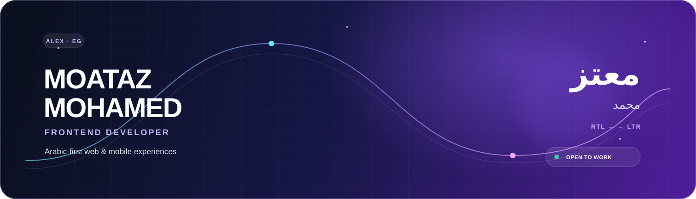

**Frontend Developer · Arabic RTL + English LTR · Alexandria, Egypt**

## About

I’m **Moataz**, a frontend developer and IT student from Alexandria, Egypt. I build polished web and mobile products, with **Arabic RTL and English LTR** considered from the start. I care about clear user flows, thoughtful interface details, and connecting the UI to reliable product behavior.

**Currently building:** WebVault & Madar · **Open to:** junior frontend roles, internships, and collaborations.

  

## Featured work

<table>
<tr>
<td width="50%" valign="top">

### 🗂️ Madar · مدار
A multi-tenant operations platform for Arabic-speaking teams. Tasks, team roles, review workflows, time tracking, and reports—all designed for an Arabic-first experience.

`React Native` · `Expo` · `TypeScript` · `Supabase`

[**Open the live app ↗**](https://madar-m.vercel.app) · [**Source code ↗**](https://github.com/moatazsmohamed/madar)
</td>
<td width="50%" valign="top">

### 🔐 WebVault
A private dashboard for organizing websites and projects, with an encrypted credentials vault and a bilingual RTL/LTR interface.

`Next.js` · `TypeScript` · `Supabase` · `PostgreSQL`

[**Try WebVault ↗**](https://webvault-app.vercel.app) · [**Source code ↗**](https://github.com/moatazsmohamed/webvault)
</td>
</tr>
</table>

## Let’s connect · خلّينا نتواصل

Have an opportunity, a product idea, or a collaboration in mind? I’d love to hear from you.

عندك فرصة أو فكرة مشروع أو حابب نتعاون؟ يسعدني تواصلك.

**ببني منتجات رقمية بتجربة عربية وإنجليزية — من الفكرة لحد الإطلاق.**

*Built with care in Alexandria, Egypt 🇪🇬*

