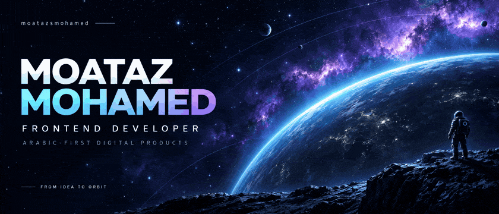
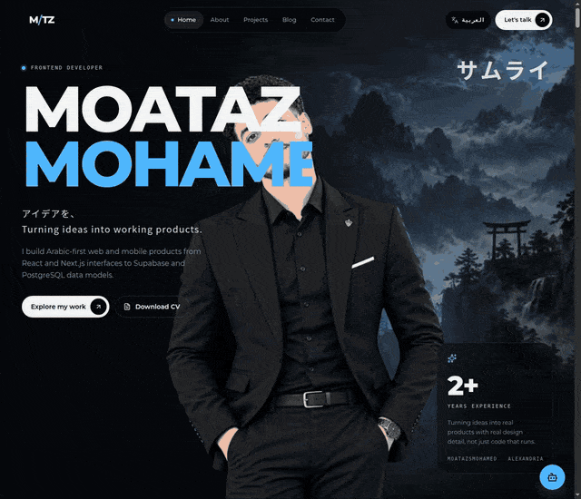
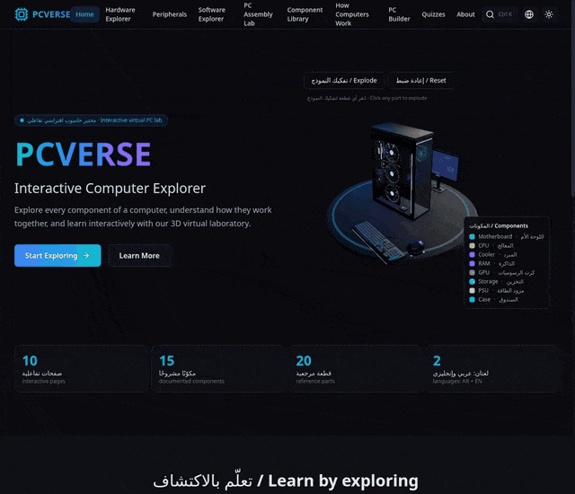
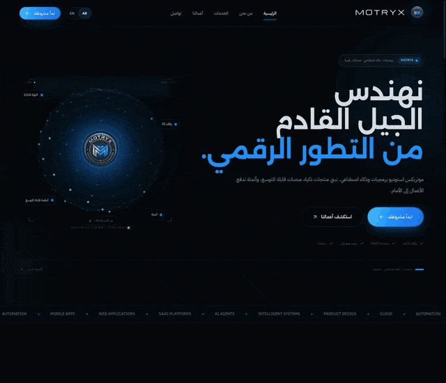
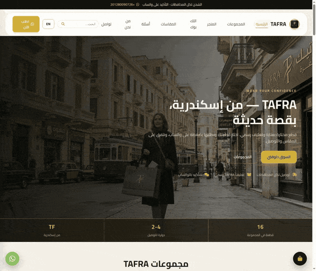
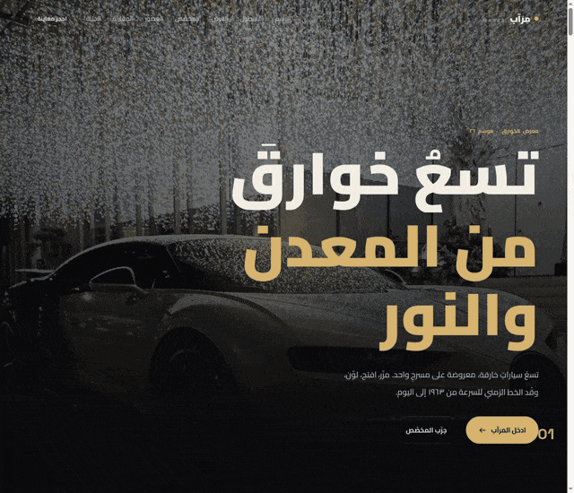
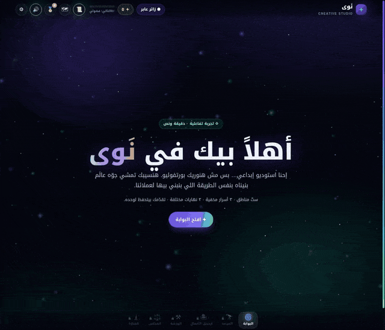

  <picture>
    <source media="(prefers-reduced-motion: reduce)" srcset="./assets/orbit-banner.png" />
    
  </picture>
  <h1>معتز محمد · Moataz Mohamed</h1>
  
<strong>Frontend Developer · Arabic-first web &amp; mobile products</strong>

  
واجهات مدروسة. تجارب تفاعلية. العربية والإنجليزية من أول يوم.

  
Alexandria, Egypt · IT Student at Borg El Arab Technological University

  
  
  

---

## Launchpad · مشاريع تستحق الاستكشاف

**Real public projects. Real screenshots. Looping page previews.** Click a preview to explore the project.

**مشاريع منشورة وصور حقيقية من واجهاتها**، بمعاينات متحركة من لقطات الصفحات. اضغط على الصورة لزيارة المشروع.

<table>
  <tr>
    <td width="50%" valign="top">
      <h3><a href="https://m3t-z.vercel.app/">M3T Portfolio</a></h3>
      <a href="https://m3t-z.vercel.app/">
        <picture>
          <source media="(prefers-reduced-motion: reduce)" srcset="./assets/projects/m3t-hero.jpg" />
          
        </picture>
      </a>
      
<strong>My main portfolio · البورتفوليو الرئيسي</strong>

      
A bilingual space for my work, journey, and project stories.

      
مساحة ثنائية اللغة لعرض أعمالي ورحلتي وقصص المشاريع.

      
<code>Next.js</code> <code>React</code> <code>TypeScript</code> <code>Vercel</code>

      
<strong>Focus:</strong> Arabic-first UX · Project storytelling · Responsive UI

    </td>
    <td width="50%" valign="top">
      <h3><a href="https://pcverse-lac.vercel.app/">PCVERSE</a></h3>
      <a href="https://pcverse-lac.vercel.app/">
        <picture>
          <source media="(prefers-reduced-motion: reduce)" srcset="./assets/projects/pcverse-hero.jpg" />
          
        </picture>
      </a>
      
<strong>Interactive computer explorer · تعلّم الكمبيوتر بالتجربة</strong>

      
Explore hardware, software, and PC assembly through 3D models and learning labs.

      
استكشاف مكوّنات الحاسوب والبرمجيات وتجميع الكمبيوتر عبر نماذج ثلاثية الأبعاد ومختبرات تعليمية.

      
<code>React</code> <code>Three.js</code> <code>TypeScript</code> <code>Vite</code>

      
<strong>Focus:</strong> 3D interaction · Bilingual learning · Educational UX

    </td>
  </tr>
  <tr>
    <td width="50%" valign="top">
      <h3><a href="https://motryx-delta.vercel.app/ar">MOTRYX</a></h3>
      <a href="https://motryx-delta.vercel.app/ar">
        <picture>
          <source media="(prefers-reduced-motion: reduce)" srcset="./assets/projects/motryx-hero.jpg" />
          
        </picture>
      </a>
      
<strong>Software &amp; AI studio · واجهة استوديو برمجيات وذكاء اصطناعي</strong>

      
A cinematic bilingual visual system for services, work, and product ideas.

      
هوية بصرية ثنائية اللغة لعرض الخدمات والأعمال والأفكار الرقمية.

      
<code>Vite</code> <code>React</code> <code>TypeScript</code> <code>Vercel</code>

      
<strong>Focus:</strong> Visual systems · Service storytelling · RTL/LTR

    </td>
    <td width="50%" valign="top">
      <h3><a href="https://tafrawear.vercel.app/">TAFRA</a></h3>
      <a href="https://tafrawear.vercel.app/">
        <picture>
          <source media="(prefers-reduced-motion: reduce)" srcset="./assets/projects/tafra-hero.jpg" />
          
        </picture>
      </a>
      
<strong>Fashion storefront · متجر أزياء من الإسكندرية</strong>

      
A black-and-gold storefront with collections, lookbook imagery, sizing guidance, and WhatsApp ordering.

      
متجر بهوية سوداء وذهبية، يضم المجموعات واللوك بوك ودليل المقاسات والطلب عبر واتساب.

      
<strong>Focus:</strong> Product browsing · Brand identity · Clear ordering flow

    </td>
  </tr>
  <tr>
    <td width="50%" valign="top">
      <h3><a href="https://car-showcase-weld.vercel.app/">Marab · مِرَآب</a></h3>
      <a href="https://car-showcase-weld.vercel.app/">
        <picture>
          <source media="(prefers-reduced-motion: reduce)" srcset="./assets/projects/marab-hero.jpg" />
          
        </picture>
      </a>
      
<strong>Luxury car showcase · معرض السيارات الخارقة</strong>

      
An Arabic RTL automotive experience with a cinematic hero, fleet cards, performance specs, and comparison sections.

      
تجربة عربية لعرض السيارات، بصور سينمائية وبطاقات للأسطول ومواصفات الأداء وأقسام للمقارنة.

      
<code>GSAP</code> <code>ScrollTrigger</code> <code>Lenis</code>

      
<strong>Focus:</strong> Motion-led storytelling · RTL design · Visual navigation

    </td>
    <td width="50%" valign="top">
      <h3><a href="https://nawa-studio-dun.vercel.app/">NAWA Studio · نَوى</a></h3>
      <a href="https://nawa-studio-dun.vercel.app/">
        <picture>
          <source media="(prefers-reduced-motion: reduce)" srcset="./assets/projects/nawa-hero.jpg" />
          
        </picture>
      </a>
      
<strong>Immersive creative world · عالم إبداعي تفاعلي</strong>

      
A space-themed Arabic studio experience built around discovery, playful navigation, and visitor progress.

      
تجربة استوديو عربية بطابع فضائي، تعتمد على الاستكشاف والتنقّل المرح وتقدّم الزائر.

      
<strong>Focus:</strong> Creative interaction · Onboarding · Exploratory UX

    </td>
  </tr>
</table>

## Flight stack · القسم التقني

  

**Web UI:** React · Next.js · Vite · TypeScript · JavaScript · Tailwind CSS
**Mobile:** React Native · Expo  
**Data & integrations:** Supabase · PostgreSQL · API integration · Auth/session flows  
**Delivery:** Git · GitHub · Vercel

  
<strong>Engineering details · تفاصيل التنفيذ</strong>

  <h3>How I build</h3>
  
I start with the user journey, define reusable components, and refine interaction details across languages and screen sizes.

  
أبدأ بمسار المستخدم، وأقسم الواجهة إلى مكوّنات قابلة لإعادة الاستخدام، وأراجع التفاعل على أحجام الشاشات المختلفة.

  <ul>
    <li><strong>Bilingual by design:</strong> Arabic RTL and English LTR navigation, content direction, and responsive layouts.</li>
    <li><strong>Predictable UI:</strong> clear loading, empty, success, and error states.</li>
    <li><strong>Connected products:</strong> practical API integration, product data, and auth/session handling.</li>
    <li><strong>Interaction craft:</strong> purposeful motion, 3D experiences, and clear feedback where the product benefits.</li>
    <li><strong>Delivery:</strong> source control, deployment, and iterative refinement.</li>
  </ul>

## Behind the interface · عنّي

I’m **Moataz**, a frontend developer and IT student from Alexandria. I build web and mobile experiences with Arabic RTL and English LTR treated as first-class interfaces.

أنا **معتز**، مطوّر Frontend وطالب IT من الإسكندرية. أبني تجارب ويب وموبايل تهتم بالعربية والإنجليزية من البداية، مع التركيز على وضوح المنتج وتفاصيل الواجهة.

Open to **junior roles, internships, and collaborations** in product-focused teams.

متاح لفرص **Junior والتدريب والتعاون** مع فرق تهتم بجودة المنتج وتجربة المستخدم.

## Public code · الكود العام

- [portfolio](https://github.com/moatazsmohamed/portfolio) — bilingual portfolio and AI assistant.
- [moataz-portfolio-v4](https://github.com/moatazsmohamed/moataz-portfolio-v4) — Next.js, Prisma, and PostgreSQL portfolio.
- [moneytrack](https://github.com/moatazsmohamed/moneytrack) — finance-tracking project.
- [moatazsmohamed.github.io](https://github.com/moatazsmohamed/moatazsmohamed.github.io) — personal website.

## Contact · تواصل

Have an opportunity, an idea, or a collaboration in mind? I’d love to hear from you.

عندك فرصة أو فكرة مشروع أو حابب نتعاون؟ يسعدني تواصلك.

[Email · mtzm2225@gmail.com](mailto:mtzm2225@gmail.com) · [LinkedIn · Moataz Mohamed](https://www.linkedin.com/in/moataz-mohamed-342b32399)

  
<strong>Built with care in Alexandria, Egypt · صُنع بعناية في الإسكندرية</strong>

