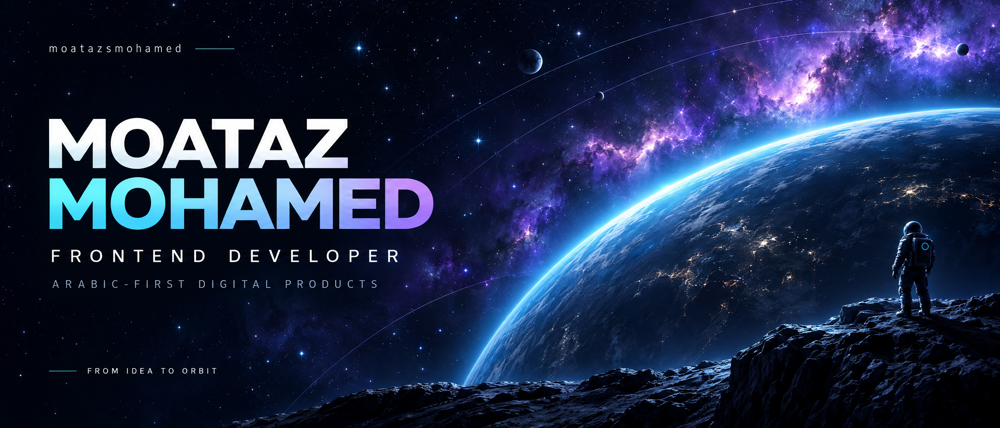

  

  <h1>معتز محمد · Moataz Mohamed</h1>

  
<strong>Frontend Developer building Arabic-first web &amp; mobile products.</strong>

  
أبني منتجات ويب وموبايل تبدأ من العربية، وتعمل بسلاسة بالعربية والإنجليزية.

  
Alexandria, Egypt · IT Student at Borg El Arab Technological University

  
  
  

---

## Mission · المهمة

I’m **Moataz**, a frontend developer and IT student based in Alexandria, Egypt. I build clear, polished web and mobile experiences with Arabic RTL and English LTR treated as first-class interfaces.

أنا **معتز**، مطوّر Frontend وطالب IT من الإسكندرية. أركز على بناء تجارب رقمية واضحة ومتقنة، مع الاهتمام الحقيقي باتجاهي الكتابة RTL وLTR.

I’m open to **junior roles, internships, and thoughtful collaborations** where product clarity, usability, and frontend craft matter.

متاح لفرص **Junior، والتدريب، والتعاونات** التي تهتم بجودة المنتج وسهولة الاستخدام وتفاصيل الواجهة.

## Flight stack · التقنيات

  

**Core stack:** React · Next.js · TypeScript · JavaScript · React Native · Tailwind CSS · Supabase · PostgreSQL · Git · GitHub · Vercel

## Launchpad · المشاريع المميزة

<table>
  <tr>
    <td width="50%" valign="top">
      <h3><a href="https://m3t-z.vercel.app/">M3TPortfolio</a></h3>
      
<strong>New main portfolio</strong> — A focused bilingual space for selected work, product thinking, and the next launch.

      
<strong>البورتفوليو الرئيسي الجديد</strong> — مساحة ثنائية اللغة لاستعراض الأعمال المختارة والأفكار القادمة.

      
<a href="https://m3t-z.vercel.app/">Open live portfolio ↗</a>

    </td>
    <td width="50%" valign="top">
      <h3><a href="https://pcverse-lac.vercel.app/">PCVERSE</a></h3>
      
A 3D learning experience that makes computer hardware easier to explore and understand.

      
تجربة تعليمية ثلاثية الأبعاد لاستكشاف مكوّنات الكمبيوتر وفهمها بطريقة تفاعلية.

      
<a href="https://pcverse-lac.vercel.app/">Explore the experience ↗</a>

    </td>
  </tr>
  <tr>
    <td width="50%" valign="top">
      <h3><a href="https://tafrawear.vercel.app/">TAFRA</a></h3>
      
A bilingual fashion store shaped around clear browsing and a smooth shopping journey.

      
متجر أزياء ثنائي اللغة بتصفح واضح وتجربة تسوق بسيطة وسلسة.

      
<a href="https://tafrawear.vercel.app/">Visit the store ↗</a>

    </td>
    <td width="50%" valign="top">
      <h3><a href="https://motryx-delta.vercel.app/ar">MOTRYX</a></h3>
      
A bilingual digital presence for a software studio, presented in Arabic and English.

      
واجهة رقمية ثنائية اللغة لاستوديو برمجيات، بالعربية والإنجليزية.

      
<a href="https://motryx-delta.vercel.app/ar">Visit MOTRYX ↗</a>

    </td>
  </tr>
</table>

## Mission log · سجل المهمة

**Understand the product → shape the flow → build the interface → refine the details.**

أبدأ بفهم المنتج واحتياج المستخدم، ثم أصمم المسار، وأبني الواجهة، وأراجع التفاصيل حتى تكون التجربة طبيعية في اللغتين.

## Public code · الكود العام

Selected public repositories:

- [portfolio](https://github.com/moatazsmohamed/portfolio)
- [moneytrack](https://github.com/moatazsmohamed/moneytrack)
- [moataz-portfolio-v4](https://github.com/moatazsmohamed/moataz-portfolio-v4)
- [moatazsmohamed.github.io](https://github.com/moatazsmohamed/moatazsmohamed.github.io)

## Contact · تواصل

Have an opportunity, a product idea, or a collaboration in mind? I’d love to hear from you.

عندك فرصة أو فكرة مشروع أو حابب نتعاون؟ يسعدني تواصلك.

- [Email · mtzm2225@gmail.com](mailto:mtzm2225@gmail.com)
- [LinkedIn · Moataz Mohamed](https://www.linkedin.com/in/moataz-mohamed-342b32399)

  
<strong>Built with care in Alexandria, Egypt · صُنع بعناية في الإسكندرية</strong>

  
© 2026 Moataz Mohamed. All rights reserved.

