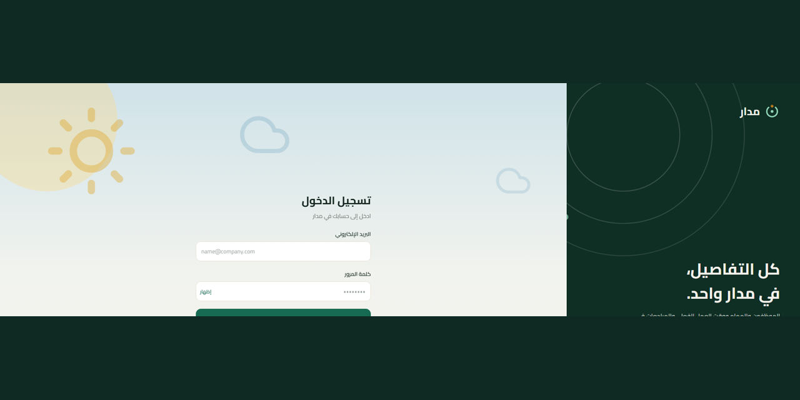
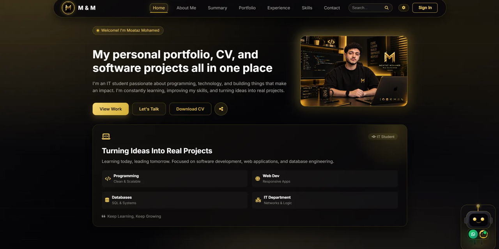
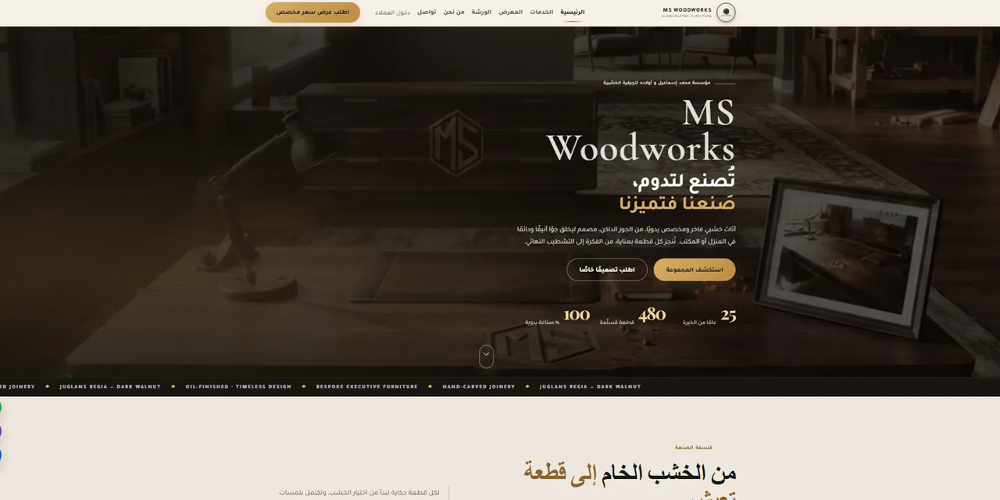

# Hi 👋 I'm Moataz — معتز محمد

**Frontend Developer** building **Arabic-first** web & mobile products — from database schema to shipped UI.

🎓 IT student at Borg El Arab Technological University · 📍 Alexandria, Egypt · 🌍 العربية / English

---

### 🔭 Currently building

**[Madar](https://github.com/moatazsmohamed/madar)** — a multi-tenant team-operations platform with a fully Arabic RTL interface: daily tasks with timers, departments and roles, monthly reports, and a developer console. Live at [madar-three-liart.vercel.app](https://madar-three-liart.vercel.app).

I own it end-to-end: PostgreSQL schema and row-level permissions, the API layer, the client experience, and the deployment.

### 🧰 Stack

###  🌟 Featured work

#### [Madar](https://github.com/moatazsmohamed/madar) — multi-tenant team management, fully Arabic RTL
Daily tasks with timers · departments and roles · monthly reports · developer console
Built end-to-end: PostgreSQL schema + row-level permissions, API layer, client, deployment.
`React Native (Expo)` `TypeScript` `Supabase` `PostgreSQL`

#### [Portfolio](https://github.com/moatazsmohamed/portfolio) — bilingual AR/EN site with an embedded AI assistant
A chat assistant that answers questions about my projects, skills and experience — plus RTL/LTR switching and live visit counters.
`JavaScript` `CSS` `HTML` `Vercel`

#### [MS Woodworks](https://github.com/moatazsmohamed/ms-wood-works) — luxury handcrafted furniture house
Marketing site for Mohamed Ismail & Sons: 25+ years of bespoke and executive office furniture, with a works gallery and materials breakdown.
`HTML` `CSS` `JavaScript`

### 📊 Activity

### 📫 Reach me

---

### نبذة بالعربي

أنا معتز محمد، مطوّر واجهات أمامية من الإسكندرية، طالب IT في جامعة برج العرب التكنولوجية.
ببني منتجات تشتغل بالعربي من أولها: قاعدة البيانات، الصلاحيات، الواجهة، والنشر.
أحدث شغلي هو **مدار** — منصة لإدارة فرق العمل متعددة الشركات، فيها المهام اليومية بمؤقّت، الأقسام والأدوار، التقارير الشهرية، وواجهة عربية RTL بالكامل.

📩 مفتوح لتدريب أو وظيفة Frontend Developer مبتدئ — راسلني على البريد أو LinkedIn.
