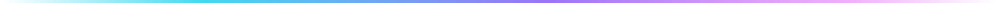
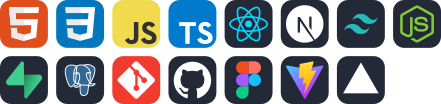
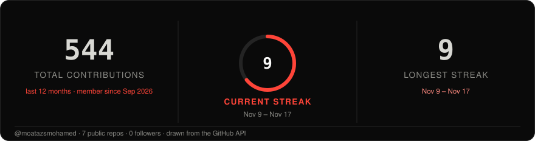
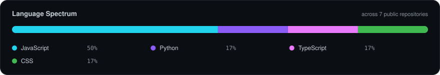
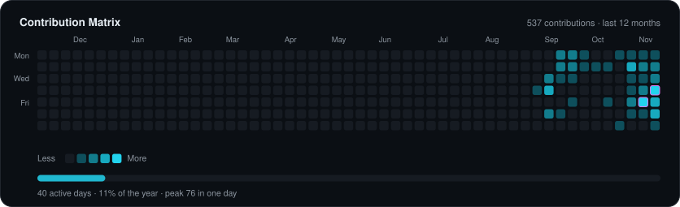

<picture>
  <source media="(prefers-color-scheme: light)" srcset="assets/hero-banner-light.svg">
  
</picture>

 

<picture>
  <source media="(prefers-color-scheme: light)" srcset="assets/typing-line-light.svg">
  
</picture>

 

  
  
  

  
  

<h2 align="center">🖥️ System Diagnostics</h2>

⚡ The terminal above is a <b>live animation</b>, not a screenshot — <a href="scripts/make_terminal_portrait.py">make_terminal_portrait.py</a> slices my photo into a 48×48 grid, quantises it to 14 colours and repaints it band by band: <b>1,692 dots</b>, then the readout types itself. Pure SVG + CSS inside GitHub markdown, no JavaScript and no third-party service.

I build Arabic-first interfaces — React and Next.js on the front, Supabase and PostgreSQL underneath, and a stubborn attention to how a page reads once the text starts running right-to-left. Six of those products are live right now: a PC-building comparison engine, a fashion storefront, a supercar showcase, an immersive studio world. Most nights I'm either shipping the next one or rebuilding a layout until both directions feel native.

<h2 align="center">🧬 Interface Engine</h2>

The terminal above <i>is</i> the engine's output. The raw artifacts — one photo turned into a dot-matrix portrait — live behind these buttons:

<b>pipeline:</b> photo → 14-colour palette quantisation → 48×48 dot grid → luminance cut → 12 staggered bands → <b>1,692 dots</b> → SVG + CSS keyframes · <b>zero manual drawing</b> — every dot, every panel below, is computed by <a href="scripts/make_terminal_portrait.py">make_terminal_portrait.py</a> and <a href="scripts/make_telemetry.py">make_telemetry.py</a>, then refreshed daily by GitHub Actions.

<h2 align="center">🚀 Active Deployments</h2>

<table>
<tr>
<td align="center" width="50%">

**🎨 M3T Portfolio**
 
Bilingual portfolio with project storytelling, motion-led case studies and Arabic RTL treated as a first-class interface
  

</td>
<td align="center" width="50%">

**🖥️ PCVERSE**
 
Build-a-PC price comparison platform — component picking, compatibility checks and a 3D learning interface
  

</td>
</tr>
</table>

| Project | Description |
|:---|:---|
| 🎨 **M3T Portfolio** | Bilingual (AR/EN) portfolio — project stories, animated previews, Next.js + React + TypeScript |
| 🖥️ **PCVERSE** | PC-building price comparison and 3D component explorer — Vite + React |
| 🏛️ **MOTRYX** | Software & AI studio site — cinematic bilingual visual system for services and work |
| 👗 **TAFRA** | Fashion storefront from Alexandria — collections, lookbook, sizing guide, WhatsApp ordering |
| 🚗 **Marab** | Luxury car showcase — GSAP scroll storytelling, fleet cards, RTL-native layout |
| 🌌 **NAWA Studio** | Immersive space-themed Arabic studio world built around exploration and progress |

<h2 align="center">🚀 Launchpad · مشاريع تستحق الاستكشاف</h2>

**Real public projects. Real screenshots. Looping page previews.** Click a preview to explore the project.

**مشاريع منشورة وصور حقيقية من واجهاتها**، بمعاينات متحركة من لقطات الصفحات. اضغط على الصورة لزيارة المشروع.

<table>
  <tr>
    <td colspan="2" width="100%" align="center" valign="top">
      <h3><a href="https://m3t-z.vercel.app/">M3T Portfolio</a></h3>
      <a href="https://m3t-z.vercel.app/">
        <picture>
          <source media="(prefers-reduced-motion: reduce)" srcset="./assets/projects/m3t-hero.jpg" />
          
        </picture>
      </a>
      
<strong>My main portfolio · البورتفوليو الرئيسي</strong>

      
A bilingual space for my work, journey, and project stories.

      
مساحة ثنائية اللغة لعرض أعمالي ورحلتي وقصص المشاريع.

      
<code>Next.js</code> <code>React</code> <code>TypeScript</code> <code>Vercel</code>

      
<strong>Focus:</strong> Arabic-first UX · Project storytelling · Responsive UI

        </td>
  </tr>
  <tr>
    <td width="50%" valign="top">
      <h3><a href="https://pcverse-lac.vercel.app/">PCVERSE</a></h3>
      <a href="https://pcverse-lac.vercel.app/">
        <picture>
          <source media="(prefers-reduced-motion: reduce)" srcset="./assets/projects/pcverse-hero.jpg" />
          
        </picture>
      </a>
      
<strong>Interactive computer explorer · تعلّم الكمبيوتر بالتجربة</strong>

      
Explore hardware, software, and PC assembly through 3D models and learning labs.

      
استكشاف مكوّنات الحاسوب والبرمجيات وتجميع الكمبيوتر عبر نماذج ثلاثية الأبعاد ومختبرات تعليمية.

      
<code>React</code> <code>Three.js</code> <code>TypeScript</code> <code>Vite</code>

      
<strong>Focus:</strong> 3D interaction · Bilingual learning · Educational UX

        </td>
    <td width="50%" valign="top">
      <h3><a href="https://motryx-delta.vercel.app/ar">MOTRYX</a></h3>
      <a href="https://motryx-delta.vercel.app/ar">
        <picture>
          <source media="(prefers-reduced-motion: reduce)" srcset="./assets/projects/motryx-hero.jpg" />
          
        </picture>
      </a>
      
<strong>Software &amp; AI studio · واجهة استوديو برمجيات وذكاء اصطناعي</strong>

      
A cinematic bilingual visual system for services, work, and product ideas.

      
هوية بصرية ثنائية اللغة لعرض الخدمات والأعمال والأفكار الرقمية.

      
<code>Vite</code> <code>React</code> <code>TypeScript</code> <code>Vercel</code>

      
<strong>Focus:</strong> Visual systems · Service storytelling · RTL/LTR

        </td>
  </tr>
  <tr>
    <td width="50%" valign="top">
      <h3><a href="https://tafrawear.vercel.app/">TAFRA</a></h3>
      <a href="https://tafrawear.vercel.app/">
        <picture>
          <source media="(prefers-reduced-motion: reduce)" srcset="./assets/projects/tafra-hero.jpg" />
          
        </picture>
      </a>
      
<strong>Fashion storefront · متجر أزياء من الإسكندرية</strong>

      
A black-and-gold storefront with collections, lookbook imagery, sizing guidance, and WhatsApp ordering.

      
متجر بهوية سوداء وذهبية، يضم المجموعات واللوك بوك ودليل المقاسات والطلب عبر واتساب.

      
<strong>Focus:</strong> Product browsing · Brand identity · Clear ordering flow

        </td>
    <td width="50%" valign="top">
      <h3><a href="https://car-showcase-weld.vercel.app/">Marab · مِرَآب</a></h3>
      <a href="https://car-showcase-weld.vercel.app/">
        <picture>
          <source media="(prefers-reduced-motion: reduce)" srcset="./assets/projects/marab-hero.jpg" />
          
        </picture>
      </a>
      
<strong>Luxury car showcase · معرض السيارات الخارقة</strong>

      
An Arabic RTL automotive experience with a cinematic hero, fleet cards, performance specs, and comparison sections.

      
تجربة عربية لعرض السيارات، بصور سينمائية وبطاقات للأسطول ومواصفات الأداء وأقسام للمقارنة.

      
<code>GSAP</code> <code>ScrollTrigger</code> <code>Lenis</code>

      
<strong>Focus:</strong> Motion-led storytelling · RTL design · Visual navigation

        </td>
  </tr>
  <tr>
    <td colspan="2" width="100%" align="center" valign="top">
      <h3><a href="https://nawa-studio-dun.vercel.app/">NAWA Studio · نَوى</a></h3>
      <a href="https://nawa-studio-dun.vercel.app/">
        <picture>
          <source media="(prefers-reduced-motion: reduce)" srcset="./assets/projects/nawa-hero.jpg" />
          
        </picture>
      </a>
      
<strong>Immersive creative world · عالم إبداعي تفاعلي</strong>

      
A space-themed Arabic studio experience built around discovery, playful navigation, and visitor progress.

      
تجربة استوديو عربية بطابع فضائي، تعتمد على الاستكشاف والتنقّل المرح وتقدّم الزائر.

      
<strong>Focus:</strong> Creative interaction · Onboarding · Exploratory UX

        </td>
  </tr>
</table>

<h2 align="center">🛠️ Arsenal & Tech Stack</h2>

  

  
<strong>Engineering details · تفاصيل التنفيذ</strong>

  <h3>How I build</h3>
  
I start with the user journey, define reusable components, and refine interaction details across languages and screen sizes.

  
أبدأ بمسار المستخدم، وأقسم الواجهة إلى مكوّنات قابلة لإعادة الاستخدام، وأراجع التفاعل على أحجام الشاشات المختلفة.

  <ul>
    <li><strong>Bilingual by design:</strong> Arabic RTL and English LTR navigation, content direction, and responsive layouts.</li>
    <li><strong>Predictable UI:</strong> clear loading, empty, success, and error states.</li>
    <li><strong>Connected products:</strong> practical API integration, product data, and auth/session handling.</li>
    <li><strong>Interaction craft:</strong> purposeful motion, 3D experiences, and clear feedback where the product benefits.</li>
    <li><strong>Delivery:</strong> source control, deployment, and iterative refinement.</li>
  </ul>

<h2 align="center">📡 Live Telemetry</h2>

<picture>
  <source media="(prefers-color-scheme: light)" srcset="assets/telemetry-light.svg">
  
</picture>

<picture>
  <source media="(prefers-color-scheme: light)" srcset="assets/activity-graph-light.svg">
  
</picture>

<picture>
  <source media="(prefers-color-scheme: light)" srcset="assets/language-spectrum-light.svg">
  
</picture>

Drawn from the GitHub GraphQL API by <a href="scripts/make_telemetry.py">make_telemetry.py</a> and committed to this repo, so nothing here can rate-limit or go dark. Regenerated daily by <a href=".github/workflows/telemetry.yml">telemetry.yml</a>.

<h2 align="center">🐍 Contribution Matrix</h2>

<picture>
  <source media="(prefers-color-scheme: light)" srcset="assets/contribution-matrix-light.svg">
  
</picture>

53 × 7 cells of real contribution data, drawn by the same <a href="scripts/make_telemetry.py">make_telemetry.py</a> pass — hover any cell to read its date and count.

<h2 align="center">🧭 Behind the interface</h2>

I’m **Moataz**, a frontend developer and IT student from Alexandria. I build web and mobile experiences where Arabic RTL and English LTR are both treated as first-class interfaces — not one translated from the other.

Open to **junior roles, internships, and collaborations** in product-focused teams.

<h2 align="center">🇪🇬 بالعربي · النسخة القصيرة</h2>

أنا **معتز محمد**، مطوّر Frontend من الإسكندرية وطالب IT في جامعة برج العرب التكنولوجية. بشتغل على منتجات ويب وموبايل بتتعامل مع العربي والإنجليزي كأنهم الاتنين لغة أولى — مش ترجمة بتحصل في الآخر.

**طريقة عملي:** أبدأ من رحلة المستخدم، أفكّك الواجهة لمكوّنات قابلة لإعادة الاستخدام، وأراجع كل تفصيلة على الاتجاهين (RTL / LTR) وعلى أحجام الشاشات المختلفة. أهتم بحالات التحميل والفراغ والخطأ زي ما أهتم بالحالة الطبيعية.

**بحب أبني:** لوحات تحكم عربية، متاجر إلكترونية، ومنتجات فيها حركة وتفاعل مدروس — لأن التفاصيل الصغيرة هي اللي بتخلي المنتج يبان محترم.

**بدور على:** فرصة Junior أو تدريب داخل فريق بيهتم بجودة المنتج، شغل عن بُعد أو من الإسكندرية.

<h2 align="center">🛰️ Now · الآن</h2>

| Track | Right now |
|:---|:---|
| 🔨 **Building** | **Madar** — a multi-tenant team-operations platform with a fully Arabic RTL interface (tasks, timers, roles, monthly reports) |
| 🧩 **Refining** | **PCVERSE** — component compatibility rules and a faster 3D explorer |
| 📚 **Learning** | Postgres data modelling with Prisma · Next.js App Router patterns · RTL-first design systems |
| 🧪 **Experimenting** | SVG as a rendering target — the dot-portrait terminal above is one output of that |
| 🎯 **Open to** | Junior frontend roles · internships · freelance UI work |
| 📍 **Based in** | Alexandria, Egypt · remote-friendly |

<h2 align="center">📦 Public code · الكود العام</h2>

- [portfolio](https://github.com/moatazsmohamed/portfolio) — bilingual portfolio and AI assistant.
- [moataz-portfolio-v4](https://github.com/moatazsmohamed/moataz-portfolio-v4) — Next.js, Prisma, and PostgreSQL portfolio.
- [moneytrack](https://github.com/moatazsmohamed/moneytrack) — finance-tracking project.
- [moatazsmohamed.github.io](https://github.com/moatazsmohamed/moatazsmohamed.github.io) — personal website.

<h2 align="center">✉️ Contact · تواصل</h2>

Have an opportunity, an idea, or a collaboration in mind? I’d love to hear from you.

عندك فرصة أو فكرة مشروع أو حابب نتعاون؟ يسعدني تواصلك.

[Email · mtzm2225@gmail.com](mailto:mtzm2225@gmail.com) · [LinkedIn · Moataz Mohamed](https://www.linkedin.com/in/moataz-mohamed-342b32399)

<h2 align="center">🤝 Let's Connect</h2>

  

<picture>
  <source media="(prefers-color-scheme: light)" srcset="assets/footer-light.svg">
  
</picture>

