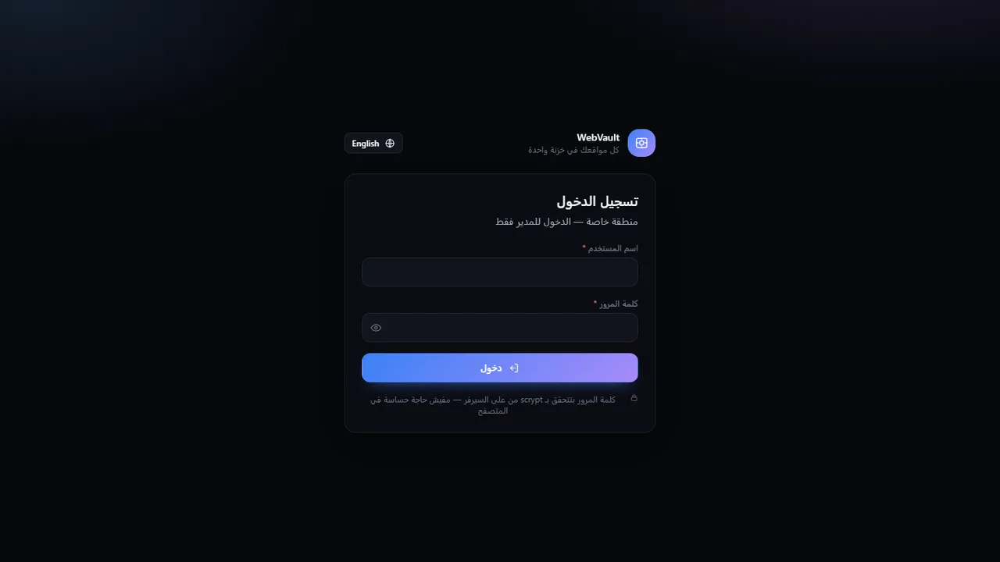
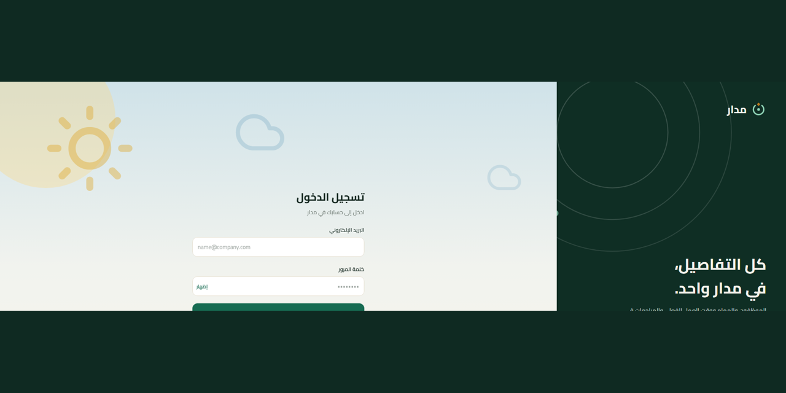

# معتز محمد · Moataz Mohamed

### Frontend Developer building Arabic-first web & mobile products

I turn ideas into polished, bilingual experiences—from data models and permissions to responsive interfaces and deployment.

📍 Alexandria, Egypt &nbsp;·&nbsp; 🎓 IT student at Borg El Arab Technological University &nbsp;·&nbsp; 🌐 Arabic & English

---

## About

I’m a frontend developer who cares about the details that make a product feel complete: clear interfaces, responsive layouts, and thoughtful **Arabic RTL / English LTR** support. I also work across the product stack—connecting interfaces to APIs, databases, and access-control rules.

- 🔭 Building **WebVault**, **Madar**, and interactive web experiences
- 💼 Open to junior frontend roles, internships, and thoughtful collaborations
- 🗣️ Arabic (native) · English

## Tech stack

**Languages**  

**Frameworks & tools**  

## Featured projects

<table>
<tr>
<td width="50%" valign="top">

### 🔐 [WebVault](https://github.com/moatazsmohamed/webvault)

A private dashboard for organizing websites, projects, and credentials.

`Next.js` `TypeScript` `Supabase` `PostgreSQL`  
AES-256-GCM encrypted credentials · Bilingual RTL/LTR UI

[Live demo ↗](https://webvault-app.vercel.app) · [Source ↗](https://github.com/moatazsmohamed/webvault)

</td>
<td width="50%" valign="top">

### 🗂️ [Madar](https://github.com/moatazsmohamed/madar)

A multi-tenant team-operations platform with a fully Arabic RTL experience.

`React Native` `Expo` `TypeScript` `Supabase`  
Tasks and timers · Departments and roles · Reports

[Live demo ↗](https://madar-m.vercel.app) · [Source ↗](https://github.com/moatazsmohamed/madar)

</td>
</tr>
<tr>
<td width="50%" valign="top">

### 🎞️ [Portfolio v3](https://github.com/moatazsmohamed/moataz-portfolio-v3)

A reel-inspired portfolio featuring interactive project posters and a project inquiry form.

`HTML` `CSS` `JavaScript`  
[Visit site ↗](https://moataz-portfolio-v3.vercel.app) · [Source ↗](https://github.com/moatazsmohamed/moataz-portfolio-v3)

</td>
<td width="50%" valign="top">

### 🧠 [MOTRYX](https://motryx-delta.vercel.app)

A bilingual digital presence for a software and AI studio, with service pages and case studies.

`Web design` `Software` `AI` `Arabic / English`  
[Visit site ↗](https://motryx-delta.vercel.app) · [More projects ↗](https://moataz-portfolio-v3.vercel.app)

</td>
</tr>
<tr>
<td width="50%" valign="top">

### 🤖 [MTZ AI](https://mtzz-ai-pi.vercel.app)

A bilingual personal AI workspace with saved conversations and private memory.

`AI` `Arabic / English` `RTL / LTR`  
[Open app ↗](https://mtzz-ai-pi.vercel.app) · [More projects ↗](https://moataz-portfolio-v3.vercel.app)

</td>
<td width="50%" valign="top">

### 🖥️ [PCVERSE](https://pcverse-lac.vercel.app)

An interactive 3D computer lab for exploring hardware and learning in Arabic and English.

`Interactive 3D` `Computer hardware` `Bilingual`  
[Explore ↗](https://pcverse-lac.vercel.app) · [More projects ↗](https://moataz-portfolio-v3.vercel.app)

</td>
</tr>
</table>

### More work

- 🚘 **[مِرَآب · Marab](https://car-showcase-weld.vercel.app)** — interactive Arabic car showcase with customization.
- 🧩 **[Computer Explorer](https://computer-explorer-three.vercel.app)** — 3D Arabic experience for exploring computer components.
- 👕 **[TAFRA](https://tafrawear.vercel.app)** — bilingual fashion storefront with search, filters, and WhatsApp ordering · [Source](https://github.com/moatazsmohamed/12.tafra).
- 🤖 **[Portfolio](https://portfolio-moataz.vercel.app)** — bilingual portfolio with an AI assistant · [Source](https://github.com/moatazsmohamed/portfolio).
- 🪵 **[MS Woodworks](https://ms-wood-works.vercel.app)** — handcrafted furniture business website · [Source](https://github.com/moatazsmohamed/ms-wood-works).

[Explore all projects on my portfolio ↗](https://moataz-portfolio-v3.vercel.app)

## GitHub activity

## تواصل معي

أنا معتز محمد، مطوّر واجهات أمامية من الإسكندرية وطالب IT في جامعة برج العرب التكنولوجية. بهتم ببناء منتجات عملية بتجربة عربية RTL وإنجليزية LTR، من الواجهة وربطها بالـ API وقاعدة البيانات لحد النشر.

💼 متاح لفرص تدريب أو وظيفة **Frontend Developer** للمبتدئين.

[البريد الإلكتروني](mailto:mtzm2225@gmail.com) · [LinkedIn](https://www.linkedin.com/in/moataz-mohamed-342b32399) · [Instagram](https://www.instagram.com/moataz_____mohamed) · [WhatsApp](https://wa.me/201280090726)
