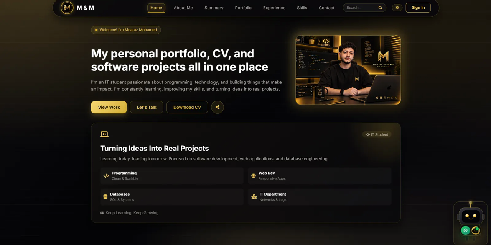
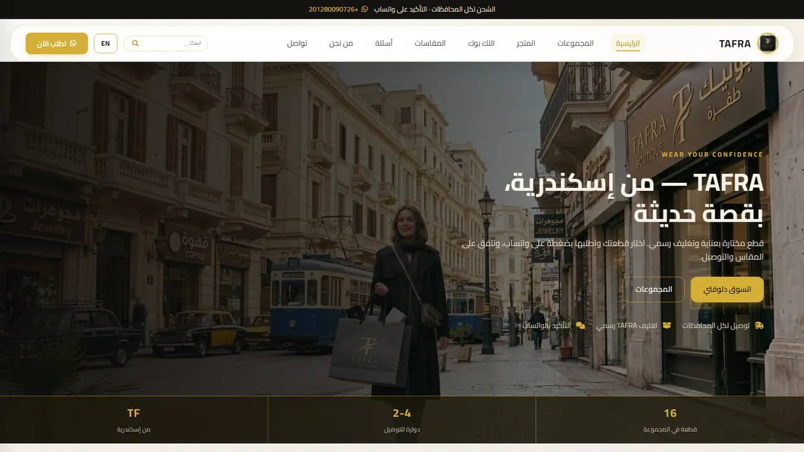
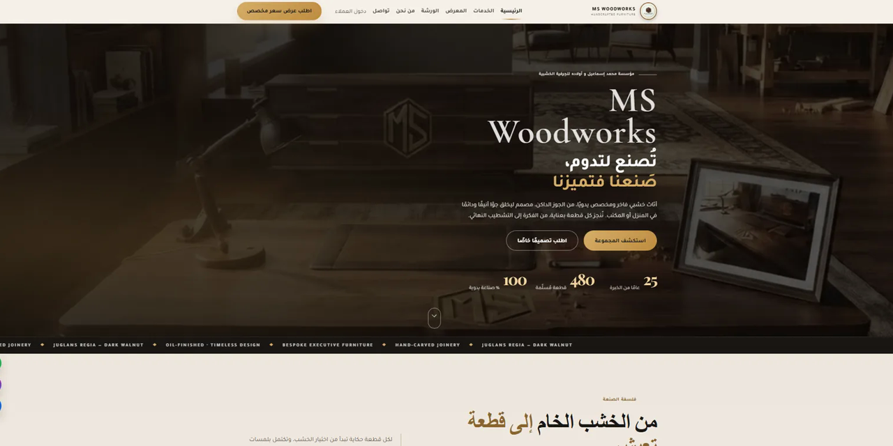

# Moataz Mohamed | معتز محمد

### Frontend Developer · Arabic-first web & mobile experiences

**I build polished, bilingual products—from database design and permissions to the interface and deployment.**

Alexandria, Egypt · IT student at Borg El Arab Technological University · العربية / English

[Portfolio](https://portfolio-moataz.vercel.app) · [GitHub Pages](https://moatazsmohamed.github.io) · [Email](mailto:mtzm2225@gmail.com) · [LinkedIn](https://www.linkedin.com/in/moataz-mohamed-342b32399)

---

## About

I’m a frontend developer focused on building useful, accessible products with thoughtful Arabic RTL and English LTR experiences. I enjoy owning the full product journey—from data models and access control to responsive UI and deployment.

Currently, I’m building **WebVault** and **Madar**, alongside client and portfolio projects.

## Featured projects

### [WebVault](https://github.com/moatazsmohamed/webvault)
A private dashboard for managing projects, links, and credentials across my sites.

- Built with Next.js 15, TypeScript, Supabase, and PostgreSQL
- Credential encryption using AES-256-GCM
- Bilingual RTL/LTR interface

[Live demo](https://webvault-app.vercel.app)

### [Madar](https://github.com/moatazsmohamed/madar)
A multi-tenant team-operations platform with a fully Arabic RTL interface.

- Daily tasks with timers, departments and roles, and monthly reports
- End-to-end implementation: database schema, row-level permissions, API, client, and deployment
- Built with React Native (Expo), TypeScript, Supabase, and PostgreSQL

[Live demo](https://madar-m.vercel.app)

### [Portfolio](https://github.com/moatazsmohamed/portfolio)
A bilingual portfolio with RTL/LTR switching and an AI assistant that answers questions about my work and experience.

[Visit portfolio](https://portfolio-moataz.vercel.app) · `JavaScript` `HTML` `CSS`

### [TAFRA](https://github.com/moatazsmohamed/12.tafra)
A bilingual streetwear storefront with product search, filtering, sorting, and WhatsApp checkout.

[Live demo](https://tafrawear.vercel.app) · `JavaScript` `HTML` `CSS` `Supabase`

### [MS Woodworks](https://github.com/moatazsmohamed/ms-wood-works)
A marketing site and works gallery for a handcrafted furniture business.

[Live demo](https://ms-wood-works.vercel.app) · `HTML` `CSS` `JavaScript`

## Tech I use

## GitHub activity

## تواصل معي

أنا معتز محمد، مطوّر واجهات أمامية من الإسكندرية وطالب IT في جامعة برج العرب التكنولوجية. أحب بناء منتجات عربية وإنجليزية بتجربة RTL/LTR متقنة، وأهتم برحلة المنتج كاملة من قاعدة البيانات والصلاحيات إلى الواجهة والنشر.

مفتوح لفرص تدريب أو وظيفة **Frontend Developer** للمبتدئين.

[البريد الإلكتروني](mailto:mtzm2225@gmail.com) · [LinkedIn](https://www.linkedin.com/in/moataz-mohamed-342b32399) · [Instagram](https://www.instagram.com/moataz_____mohamed) · [WhatsApp](https://wa.me/201280090726)
