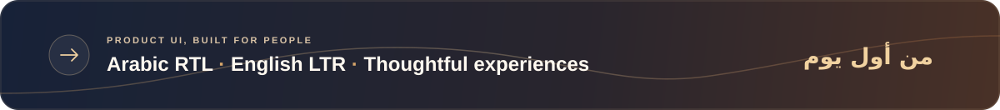

## About

I’m **Moataz**, a frontend developer and IT student based in Alexandria, Egypt. I build responsive web and mobile products with **Arabic RTL and English LTR** considered from the start—not added as an afterthought.

I enjoy the full product journey: turning an idea into a useful interface, connecting it to data and permissions, and shipping it for people to use.

- 🔭 Building **WebVault** and **Madar**
- 🧭 Focused on frontend engineering, product UI, and bilingual experiences
- 💼 Open to junior frontend roles, internships, and collaborations
- 🗣️ Arabic (native) · English

## Tech stack

  

## Selected projects

<table>
<tr>
<td width="50%" valign="top">

### 🔐 WebVault
A private dashboard for organizing websites, projects, and credentials, with an encrypted credential vault and a bilingual RTL/LTR interface.

`Next.js` · `TypeScript` · `Supabase` · `PostgreSQL`

[Live demo ↗](https://webvault-app.vercel.app) · [Source code ↗](https://github.com/moatazsmohamed/webvault)
</td>
<td width="50%" valign="top">

### 🗂️ Madar · مدار
A multi-tenant team-operations platform with a fully Arabic RTL experience: tasks and timers, departments, roles, and reports.

`React Native` · `Expo` · `TypeScript` · `Supabase`

[Live demo ↗](https://madar-m.vercel.app) · [Source code ↗](https://github.com/moatazsmohamed/madar)
</td>
</tr>
<tr>
<td width="50%" valign="top">

### 🎞️ Portfolio v3
A reel-inspired portfolio with interactive project posters and a project inquiry form.

`HTML` · `CSS` · `JavaScript`

[Explore ↗](https://moataz-portfolio-v3.vercel.app) · [Source code ↗](https://github.com/moatazsmohamed/moataz-portfolio-v3)
</td>
<td width="50%" valign="top">

### 🧠 MOTRYX
A bilingual digital presence for a software and AI studio, with service pages and case studies.

`Web design` · `Software` · `AI` · `Arabic / English`

[Visit MOTRYX ↗](https://motryx-delta.vercel.app) · [More projects ↗](https://moataz-portfolio-v3.vercel.app)
</td>
</tr>
<tr>
<td width="50%" valign="top">

### 🤖 MTZ AI
A bilingual AI workspace for saved conversations and personal memory.

`AI` · `Arabic / English` · `RTL / LTR`

[Open MTZ AI ↗](https://mtzz-ai-pi.vercel.app) · [More projects ↗](https://moataz-portfolio-v3.vercel.app)
</td>
<td width="50%" valign="top">

### 🖥️ PCVERSE
An interactive 3D computer lab for exploring hardware in Arabic and English.

`Interactive 3D` · `Computer hardware` · `Bilingual learning`

[Explore PCVERSE ↗](https://pcverse-lac.vercel.app) · [More projects ↗](https://moataz-portfolio-v3.vercel.app)
</td>
</tr>
</table>

### More projects

- 🧩 **[Computer Explorer](https://computer-explorer-three.vercel.app)** — interactive 3D guide to computer components, in Arabic.
- 🚘 **[مِرَآب · Marab](https://car-showcase-weld.vercel.app)** — Arabic interactive car showcase with customization.
- 👕 **[TAFRA](https://tafrawear.vercel.app)** — bilingual fashion storefront with search, filters, and WhatsApp ordering · [Source](https://github.com/moatazsmohamed/12.tafra).
- 🌐 **[Personal Portfolio](https://portfolio-moataz.vercel.app)** — bilingual portfolio with an AI assistant · [Source](https://github.com/moatazsmohamed/portfolio).
- 🪵 **[MS Woodworks](https://ms-wood-works.vercel.app)** — handcrafted furniture business website · [Source](https://github.com/moatazsmohamed/ms-wood-works).

## GitHub activity

## تواصل معي

أنا معتز محمد، مطوّر واجهات أمامية من الإسكندرية وطالب IT. ببني منتجات رقمية بتجربة عربية وإنجليزية من البداية، وباهتم بالتفاصيل من الواجهة لحد ربط البيانات والنشر.

متاح لفرص تدريب أو وظيفة **Frontend Developer** للمبتدئين.

[البريد الإلكتروني](mailto:mtzm2225@gmail.com) · [LinkedIn](https://www.linkedin.com/in/moataz-mohamed-342b32399) · [Instagram](https://www.instagram.com/moataz_____mohamed) · [WhatsApp](https://wa.me/201280090726)

*Built with care in Alexandria, Egypt 🇪🇬*

